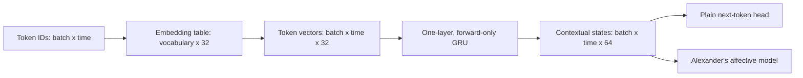
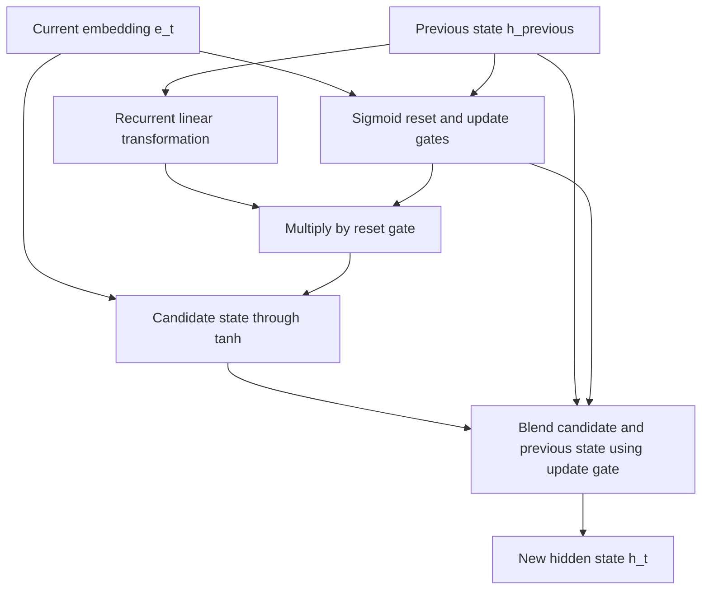
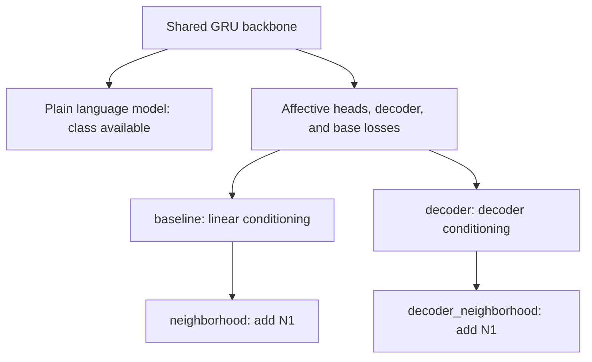

# GRU Backbone and Research Method Choices

## The Key Distinction

`GRUBackbone` is a reusable **text encoder**, not a manifold algorithm by itself.
It converts a sequence of token IDs into a sequence of context-dependent vectors.
What we attach to those vectors, what losses we optimize, and how we measure
geometry determine the full research method.

There are three different kinds of change to distinguish:

| Change | Example | Research question |
| --- | --- | --- |
| Backbone | Replace the GRU with an LSTM | Does the sequence encoder affect the result? |
| Objective or output head | Predict VAD directly instead of reconstructing features | Do the manifold objectives add value? |
| Geometry or conditioning | Add neighborhood loss or decoder conditioning | Does this particular geometric extension help? |

Moving code into a reusable class is an organizational change, not a new scientific
method. Using that class with a different objective can define a useful comparison
method, but improvement must be demonstrated with controlled experiments.

## 1. What GRUBackbone Actually Does

The implementation is in [shared core.py](../small_language_model/core.py):

```python
self.embedding = nn.Embedding(vocabulary_size, embedding_dim, padding_idx=0)
self.recurrent = nn.GRU(embedding_dim, hidden_dim, batch_first=True)
```

With the defaults, the data flow is:



- The embedding table learns one vector per vocabulary entry. It is randomly
  initialized, not a pretrained semantic dictionary.
- The GRU reads the sequence in order. Its state at position $t$ depends on the
  current token and earlier states, not future tokens.
- `batch_first=True` specifies tensor layout, not bidirectional processing.
- `encode_tokens` returns every time step's state. PyTorch also returns a final
  state tensor, which this wrapper discards.
- No initial state is passed, so PyTorch starts each call with zeros. This API
  does not maintain a person's memory or carry state between separate sentences.

The pad embedding at ID 0 receives no embedding gradients and starts at zero.
However, a GRU can still evolve on a zero input through its recurrent weights
and biases. Alexander therefore masks padded positions when averaging states,
and ignores padding targets in cross-entropy. A zero embedding is not the same
as skipping a recurrent step. The current loader uses right padding.

### Why Context Helps

Consider "I am happy" and "I am not happy." The embedding for "happy" is the
same lookup vector in both sentences. Its GRU state can differ because the
preceding states encode different prefixes. This gives the model a way to learn
order, negation, and context. It does not guarantee that a small dataset will
teach those patterns reliably.

## 2. The Mathematics Inside the GRU

GRU means **gated recurrent unit**. It learns how much previous information to
retain and how to construct a new candidate state. Let $e_t$ be the current
embedding and $h_{t-1}$ the previous hidden state. PyTorch's GRU convention is:

$$r_t=\sigma(W_{ir}e_t+b_{ir}+W_{hr}h_{t-1}+b_{hr}),$$

$$u_t=\sigma(W_{iu}e_t+b_{iu}+W_{hu}h_{t-1}+b_{hu}),$$

$$\widetilde h_t=\tanh\left(W_{in}e_t+b_{in}
+r_t\odot(W_{hn}h_{t-1}+b_{hn})\right),$$

$$h_t=(1-u_t)\odot\widetilde h_t+u_t\odot h_{t-1}.$$

Here $\sigma$ is the sigmoid, $\odot$ is elementwise multiplication, and all
gates are vectors with one entry per hidden dimension. We use $u_t$ for the
update gate to avoid confusing it with the model's latent variables $z_a,z_p$.
PyTorch commonly denotes this gate by $z_t$.

| Quantity | Interpretation |
| --- | --- |
| Reset gate $r_t$ | Controls the previous state's transformed contribution to the candidate |
| Update gate $u_t$ | Near one retains the old state; near zero favors the candidate, under this convention |
| Candidate $\widetilde h_t$ | Proposed new content, combining the token and gated recurrent contribution |
| State $h_t$ | Coordinate-wise blend of retained and candidate information |

Some textbook GRUs place the reset gate before the recurrent matrix multiplication.
The equation above matches PyTorch's placement after that transformation; these
forms are not generally interchangeable. The actual operations are performed by
`nn.GRU`, not hand-written in our wrapper. See the
[PyTorch GRU reference](https://docs.pytorch.org/docs/stable/generated/torch.nn.GRU.html).



The retention path can help gradients and information persist across tokens,
compared with an ungated recurrent network. It does not remove all vanishing
gradient problems or guarantee arbitrarily long memory. Training uses
backpropagation through the sequence to learn embeddings, gates, and heads.

## 3. Why Use It in This Project?

The GRU provides an order-sensitive, causal representation without loading any
existing language model. It is a reasonable small experimental backbone because:

- It supports scratch training under the project's no-pretrained-LLM constraint.
- Its fixed-size recurrent state gives a compact interface for affective heads.
- Its relatively small configuration makes matched experiments practical.
- The same token states support language prediction and sentence-level pooling.

These are engineering reasons, not evidence that a GRU is the best emotion model.
A recurrent encoder processes time steps sequentially, compresses history into
finite state, and may learn weak semantics from EmoBank alone. A Transformer can
parallelize training across positions more effectively, while having different
memory and data requirements. Speed should be measured, not assumed.

In the full affective model, the backbone is trainable, not frozen. Its outputs
change as the language and applicable research losses update it. The reconstruction
target is detached within each forward pass, but that does not freeze the GRU
across optimizer steps.

### How Alexander References the Shared Code

```python
from small_language_model.core import GRUBackbone

class EmotionLanguageModel(GRUBackbone):
    # Research-specific heads, decoder, and objectives live in Alexander/model.py.
    ...
```

The actual class in [model.py](model.py) inherits the embedding and recurrent
layers and calls `self.encode_tokens(tokens)`. Inheritance reuses implementation;
it does not share one set of weights between separately created model instances.
The shared core does not import Alexander's mathematics.

## 4. Methods Already Present

### Plain Causal Language Model

`CausalLanguageModel` in [core.py](../small_language_model/core.py) adds only a
token head:

$$P(x_{t+1}\mid x_{\le t})=\operatorname{softmax}(W_o h_t+b_o).$$

This class is implemented and tested. It has no VAD input, affect/private
posteriors, reconstruction decoder, or manifold losses. It can serve as a
language-only control, but **it is not a selectable variant in Alexander's
training or comparison CLI**. A matched training/evaluation route would need to
be added before reporting a controlled comparison.

### Four Affective Research Variants

All four use the same GRU backbone, Gaussian heads, feature decoder, and base
losses: next-token prediction, reconstruction, VAD anchoring, covariance, and KL.
In particular, **`baseline` does not mean plain GRU language modeling**.

| CLI variant | Token-state conditioning | Neighborhood objective | Main comparison question |
| --- | --- | --- | --- |
| `baseline` | $h_t+W_a a$ | Off | Reference text-only affective model |
| `neighborhood` | $h_t+W_a a$ | On | Does label-distance matching help? |
| `decoder` | $h_t+D(a,p_t)-D(0,p_t)$ | Off | Does using the decoder for generation help? |
| `decoder_neighborhood` | $h_t+D(a,p_t)-D(0,p_t)$ | On | How do those two extensions interact? |

Here $a$ is requested VAD and $p_t$ is inferred from the causal prefix state.
The linear variants already contain a reconstruction decoder whose geometry
can be measured; the decoder variants additionally use it in token conditioning.
The neighborhood objective matches Euclidean distances between posterior means
to human-label distances. It does not train on graph shortest-path distances.



The matched four-variant workflow already exists:

```sh
python -m Alexander.compare_manifold_variants --csv Ethan/data/emobank/emobank_pilot_1000.csv --epochs 2 --seeds 42 --run-dir Alexander/artifacts/method_check --report-dir Alexander/manifold_results/method_check
```

Run from the repository root after installing
[visualization requirements](visualization/requirements.txt). Use new output
directories; the runner refuses to overwrite prior comparisons. This short pilot
is a software check, not evidence of superiority. Test evaluation is off by default.

## 5. Alternative Methods Worth Comparing

The methods below are **proposed controls or architecture changes**, not additional
implemented CLI variants. All can be designed without pretrained models or LLM calls.

| Proposed method | What changes | Why compare it? | Important limitation |
| --- | --- | --- | --- |
| Training-mean VAD predictor | Predict the same training-label mean for every sentence | Establish whether text prediction beats a trivial reference | No text dependence or geometry; a test MAE/RMSE reference already exists in the trainer |
| Mean token embeddings plus VAD regression | Remove recurrence and regress VAD from pooled learned embeddings | Test whether sequence order adds value beyond word content | Loses word-order information |
| GRU plus direct VAD regression | Keep the encoder; replace variational heads/decoder with a deterministic VAD head | Test whether the research objectives beat straightforward supervised prediction | No generative feature manifold; language loss would need an explicit design choice |
| Deterministic affect/private autoencoder | Remove posterior sampling and KL while retaining reconstruction/anchoring | Isolate the contribution of variational modeling | Removing two ingredients at once does not distinguish their individual effects |
| Frozen scratch-trained GRU plus research heads | Train the GRU locally first, then freeze it while fitting heads/decoder | Separate moving-feature effects from geometry learning | Requires a documented two-stage protocol and equal-data controls |
| LSTM backbone | Replace GRU recurrence with input, forget, and output gates plus a cell state | Test a different recurrent memory mechanism | More parameters at equal hidden width; must control capacity/budget |
| Small causal Transformer trained from scratch | Replace recurrence with masked attention and positional information | Test a different way of relating tokens across positions | Different compute/data demands; attention masks are essential for causality |
| PCA or Isomap on fixed sentence features | Fit post-hoc coordinates to an encoder's training features | Compare explicit decoder geometry with feature-based dimensionality reduction | Not a drop-in language model; needs a defined held-out transform and fair information access |

These alternatives ask different questions. Swapping the backbone and removing
losses simultaneously makes it hard to identify why results changed. Start with
a controlled direct-VAD baseline, then isolate individual loss or conditioning
changes before increasing architecture complexity.

## 6. Backbone Geometry Is Not Decoder Geometry

The GRU computes a sequence of hidden states. A scatterplot of those states does
not establish that the data lie on a particular smooth low-dimensional manifold.
The specific geometry analyzed in this project comes from fixing a private code
and varying the decoder's affect input:

$$f_p(a)=D(a,p),\qquad J_p(a)=\frac{\partial f_p(a)}{\partial a},\qquad
G_p(a)=J_p(a)^T J_p(a).$$

Where $J_p$ has rank three, this gives locally immersed three-dimensional
geometry. It does not prove global injectivity or emotional validity. The GRU
influences the features and the coordinates visited by sentences; the decoder
defines the feature-space map used for the metric.

Changing the backbone changes the learned feature space as well as its scale
and possibly dimension. Raw decoder lengths are therefore not automatically
comparable across different encoders. Full rank can also occur with random
weights. Compare label agreement, prediction quality, and appropriate random or
simple controls, not just attractive surfaces or nonzero singular values.

For the detailed loss and metric derivations, see
[MATH_WALKTHROUGH.md](MATH_WALKTHROUGH.md). For exactly which components depart
from the article, see [ARTICLE_DIFFERENCES.md](ARTICLE_DIFFERENCES.md). Replacing
the article's pretrained features with a scratch GRU is already recorded as A1;
it is not a reproduction of the original feature extraction method.

## 7. How to Make a Defensible Comparison

1. State the question first: backbone choice, objective choice, or geometry choice.
2. Keep dataset splits, vocabulary construction, token limits, and preprocessing
   matched. Fit vocabulary and any dimensionality reduction on training data only.
3. For the current four variants, keep their common development selection objective.
   For unlike objectives, choose and document a comparable selection criterion
   in advance; a sum of different loss terms is not a fair common score.
4. Match random seeds and report parameter counts, training budgets, and repeated-run
   variability. Equal hidden width does not imply equal capacity across architectures.
5. Compare VAD MAE, RMSE, and R-squared where models actually predict VAD. Do not
   assign VAD metrics to a language-only model without a separately defined probe.
6. Compare perplexity only with compatible tokenization and conditioning. The current
   affective model receives ground-truth VAD during evaluation; the plain language
   model does not. A difference would not isolate the effect of manifold learning.
7. Evaluate affect spread, neighborhood agreement, rank across private references,
   and distance agreement alongside prediction quality. Rank alone is insufficient.
8. Use development data for method choices and reserve test data for final evaluation.

The saved one-seed, two-epoch pilots establish that the pipeline runs, not which
method is scientifically best. Adding a new method requires implementation,
tests, and a documented protocol before it can support a research conclusion.