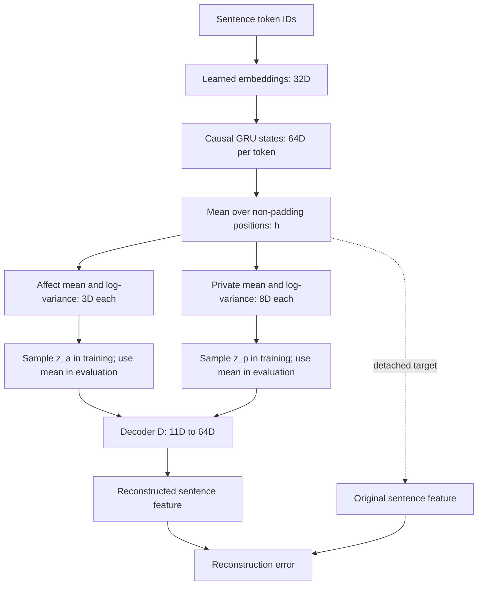
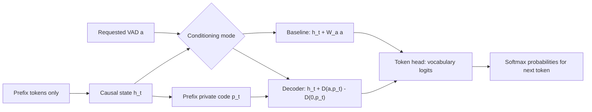
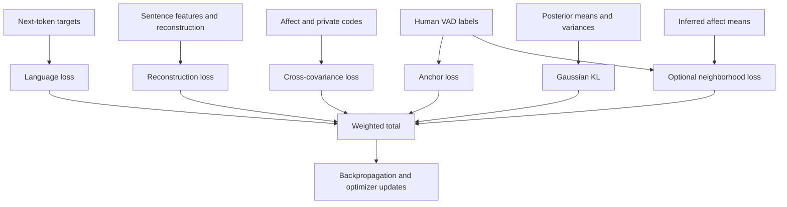
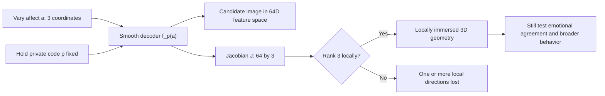

# How the Affective Model Builds Candidate Manifold Geometry

**The central idea:** text is encoded into affect and private coordinates. A
decoder maps those coordinates back into sentence-feature space. With the private
code held fixed, varying three affect coordinates traces a candidate 3D manifold
in that higher-dimensional space. Training makes this representation useful;
separate diagnostics check its local geometry and emotional agreement.

## 1. What the Symbols Mean

These are the default architecture dimensions, not discovered dimensions:

| Symbol | Meaning | Shape for one sentence |
| --- | --- | --- |
| $x_t$ | Token ID at position $t$ | Integer |
| $e_t$ | Learned token embedding | 32 coordinates |
| $h_t$ | Causal GRU state | 64 coordinates |
| $h$ | Mean of non-padding GRU states | 64 coordinates |
| $y$ | Human valence, arousal, dominance label | 3 coordinates |
| $a$ | Requested VAD for generation | 3 coordinates |
| $z_a$ | Inferred affect code | 3 coordinates |
| $z_p$ | Inferred private code | 8 coordinates |
| $D(z_a,z_p)$ | Reconstructed sentence feature | 64 coordinates |

Valence describes pleasantness, arousal describes activation, and dominance
describes perceived control. Labels are normalized to [-1, 1]; inferred means
are not bounded to that interval. The private code is intended to carry residual
information, but it is not guaranteed to contain only non-emotional content.

## 2. From Text to Coordinates

### Step 1: Encode the Sentence

The shared [GRU backbone](../small_language_model/core.py) computes:

$$e_t=E[x_t],\qquad h_t=\operatorname{GRU}(e_t,h_{t-1}).$$

Each $h_t$ depends only on the prefix through $t$. The embedding and GRU start
with random weights; no pretrained language model supplies these features.

For sentence-level inference, the model computes a masked average:

$$h=\frac{\sum_t m_t h_t}{\max(1,\sum_t m_t)},\qquad
m_t=\mathbf{1}[x_t\ne\text{padding}].$$

Padding should not change a sentence's representation, which is why it is masked.
The pooled vector sees the whole sentence, so it must not feed back into the
next-token prediction path for that same sentence.

### Step 2: Infer Two Gaussian Codes

Separate linear heads predict means and log-variances:

$$q(z_a,z_p\mid h)=q(z_a\mid h)q(z_p\mid h),$$
$$q(z_k\mid h)=\mathcal{N}\!\left(\mu_k(h),
\operatorname{diag}(\exp(\ell_k(h)))\right),\qquad k\in\{a,p\}.$$

Here $\ell_k=\log\sigma_k^2$. The code clamps log-variances to [-10, 10] to
limit extreme sampling scales. Separate heads define a factorized conditional
posterior; they do not prove that the learned coordinates are independent across
the dataset.

### Step 3: Sample Without Breaking Gradients

During training:

$$z_k=\mu_k+\exp(\ell_k/2)\odot\epsilon_k,
\qquad\epsilon_k\sim\mathcal{N}(0,I).$$

The factor of one-half converts log-variance to standard deviation. Randomness
is isolated in $\epsilon_k$, so gradients can flow through both $\mu_k$ and
$\ell_k$. Evaluation uses the means instead, making coordinates deterministic.
Sampling trains around inferred coordinates; it does not guarantee useful
representations everywhere in latent space.

## 3. How Emotion Conditions Language

The requested emotion $a$ and inferred affect $z_a$ have different jobs:
the former controls token prediction; the latter represents the input sentence.

The baseline uses:

$$P(x_{t+1}\mid x_{\le t},a)
=\operatorname{softmax}\!\left(W_o(h_t+W_a a)+b_o\right).$$

The optional decoder variant, extension G1, instead uses:

$$p_t=F_{p,\mu}(h_t),\qquad
\Delta h_t=D(a,p_t)-D(0,p_t).$$

Subtracting the zero-VAD decoder output centers the intervention relative to
the same prefix code. This lets language loss train the decoder as well as the
token head. It is not movement along a computed geodesic. Neither mode feeds
the whole-sentence posterior into token prediction, avoiding future-token leakage.

## 4. Why Each Training Loss Exists

The losses shape the learned coordinates and decoder. They do not explicitly
enforce decoder rank, global injectivity, or scientific validity.

### Language: Retain Predictive Text Information

$$L_{\mathrm{language}}=-\frac{1}{N}\sum_{\text{non-padding targets}}
\log P(x_{t+1}\mid x_{\le t},a).$$

This is cross-entropy over next-token targets, averaged over non-padding tokens.
It gives the shared GRU a language-learning task rather than only a feature
reconstruction task. It is an addition to the article's objective.

### Reconstruction: Tie the Codes to Sentence Features

$$L_{\mathrm{self}}=\frac{1}{B}\sum_i
\left\|D(z_{a,i},z_{p,i})-\operatorname{stopgrad}(h_i)\right\|_2^2.$$

The decoder must reconstruct the encoder feature from the two codes.
`stopgrad` prevents gradients through the target side; gradients still reach
the encoder through the inferred codes. Because the target encoder is also
learning, reconstruction alone cannot rule out collapse. The private code may
also carry most of the reconstructive information.

### Anchoring: Give the Three Affect Axes Meaning

$$L_{\mathrm{anchor}}=\frac{1}{B}\sum_i\|z_{a,i}-y_i\|_2^2.$$

Human VAD labels encourage each coordinate to correspond to its intended axis
and scale. Without such supervision, an arbitrary rotation of latent coordinates
could still reconstruct features without identifiable VAD meanings.
For a sampled Gaussian code:

$$\mathbb{E}\|z_a-y\|^2=\|\mu_a-y\|^2+\sum_j\sigma_{a,j}^2.$$

Thus this loss pressures both mean accuracy and lower sampling variance; it
competes with the KL term, which prefers unit variance.

### Decorrelation: Discourage Linear Redundancy

For batch matrices $A$ and $P$ of sampled affect and private codes:

$$C=\frac{(A-\bar A)^T(P-\bar P)}{B-1},\qquad
L_{\mathrm{dec}}=\|C\|_F^2.$$

Centering removes offsets. The squared Frobenius norm sums the squares of all
cross-covariance entries. This discourages linear correlation between the code
groups, not all nonlinear dependence. A singleton batch skips the term because
the sample covariance denominator would be zero.

### KL: Regularize the Posterior Distributions

$$L_{\mathrm{KL}}=\frac{1}{2B}\sum_{i,k,j}
\left(\mu_{k,ij}^2+\exp(\ell_{k,ij})-1-\ell_{k,ij}\right).$$

This is the analytic KL divergence from the two diagonal Gaussian posteriors
to standard-normal priors. Its minimum is at zero mean and unit variance.
It discourages uncontrolled mean/variance growth, but too much pressure can
erase input information. It is not a curvature penalty or a sentence distance.

### Optional Neighborhood Loss: Preserve Label Distances

Extension N1 selects non-self nearest neighbors using human VAD labels within
each batch, then compares inferred-mean distances on those edges:

$$L_N=\frac{1}{|\mathcal{E}|}\sum_{(i,j)\in\mathcal{E}}
\left(\|\mu_{a,i}-\mu_{a,j}\|_2-\|y_i-y_j\|_2\right)^2.$$

This encourages local label separations to survive in affect coordinates. It
matches Euclidean coordinate distances, not decoder-induced geodesic distances.
It is our extension, not an equation from the source article.

### The Combined Objective

For this text-only implementation:

$$L=L_{\mathrm{language}}+L_{\mathrm{self}}
+\lambda_{\mathrm{sup}}L_{\mathrm{anchor}}
+\lambda_{\mathrm{dec}}L_{\mathrm{dec}}
+\lambda_{\mathrm{KL}}\beta L_{\mathrm{KL}}
+\lambda_N L_N.$$

Defaults are $\lambda_{\mathrm{sup}}=5$, $\lambda_{\mathrm{dec}}=0.1$,
$\lambda_{\mathrm{KL}}=0.01$, and $\beta=1$. The neighborhood weight is zero
unless a neighborhood variant is selected; its default enabled weight is 0.1.
Cross-modal and lexicon terms are inactive because their required data is absent.
Squared-error helpers sum over features and average over examples, rather than
averaging over every tensor element.

## 5. Where the Manifold Comes From

A manifold is locally describable by a fixed number of independent coordinates.
It need not visibly curve: a plane is also a manifold. Here we choose three
affect coordinates and investigate the image of a learned smooth decoder.

Fix one private vector $p$ and define:

$$f_p:\mathbb{R}^3\rightarrow\mathbb{R}^{64},\qquad f_p(a)=D(a,p).$$

The decoder's linear layers and GELU activation form a smooth map. Smoothness
alone is insufficient: a constant decoder is smooth but maps every point to one
feature vector. The Jacobian checks whether affect changes produce independent
local feature changes:

$$J(a)=\frac{\partial f_p(a)}{\partial a}\in\mathbb{R}^{64\times3}.$$

If $J$ has rank three, the decoder is an immersion at that point and defines a
local 3D parameterized patch. This does not establish a globally embedded
manifold: distant coordinates might map to the same features. Tests at sampled
points also say nothing definitive about unsampled regions. Three affect axes
remain a modeling assumption, not evidence that emotion intrinsically has dimension three.

## 6. Measuring Distance on the Decoder Image

For a small coordinate displacement $da$, the feature displacement is approximately
$df=J\,da$. Ordinary Euclidean feature distance therefore gives:

$$ds^2=\|J\,da\|_2^2=da^T G(a)\,da,\qquad G(a)=J(a)^T J(a).$$

$G$ is the **pullback metric**: it expresses feature-space distance in affect
coordinates. At full column rank it is positive definite; otherwise it is only
positive semidefinite and loses at least one local direction.

For example, if $J$ stretches three orthogonal directions by factors 2, 1, and
0.5, then $G=\operatorname{diag}(4,1,0.25)$. Equal coordinate steps do not have
equal feature-space lengths. If the third stretch becomes zero, rank drops to
two and the third direction cannot distinguish nearby decoded points.

The code uses singular values of $J$ to estimate numerical rank. Tolerances
matter; adding a positive ridge to $G$ would hide rather than repair lost rank.
All these calculations use the full feature space, not the PCA display.

For a path $a(t)$, its induced length is:

$$L[a]=\int_0^1\sqrt{\dot a(t)^T G(a(t))\dot a(t)}\,dt.$$

`segment_lengths` samples a straight coordinate segment, decodes it, and sums
feature-space chord lengths. More subdivisions refine that length estimate; they
do not find the shortest continuous path. `graph_distances` connects coordinate
neighbors, weights edges with those lengths, and finds shortest graph routes.
Those routes are approximations, depend on sampling and connectivity, and can
leave disconnected pairs at infinite distance. A graph path may be longer than
the directly decoded straight path because that direct edge is not available.

## 7. Reading the Figures

| Figure | What it shows | What it does not establish |
| --- | --- | --- |
| Learned and human VAD point clouds | Inferred means versus human label spread on matched axes | A point cloud does not prove a smooth manifold |
| Fixed-dominance decoder slice | Vary valence/arousal while holding dominance and private code fixed; project decoded features onto training PCA axes | This is a 2D slice of the candidate 3D image, not its full geometry |
| Smallest Jacobian singular value | Local sensitivity in the weakest affect direction, computed in full feature space | Nonzero values do not prove accurate VAD prediction |
| Decoded paths | Projected straight-coordinate and sampled graph routes | Visual length in PCA is not full-space path length or proof of an exact geodesic |

The saved two-epoch pilot shows a much tighter inferred affect cloud than the
human labels. That is consistent with weak differentiation or collapse toward
similar predictions. Full local decoder rank can coexist with this: the decoder
can respond to coordinates even while the encoder uses only a tiny region.
A nearly planar slice is not automatically a defect, and visually different PCA
orientations across models are not by themselves evidence of better geometry.

## 8. What to Change and What to Verify

| Research question | Edit | Check |
| --- | --- | --- |
| How should affect and private information separate? | [model.py](model.py), [manifold_losses.py](manifold_losses.py) | Reconstruction, VAD accuracy, dependence, and information leakage |
| What geometry should neighbor relations encourage? | [geometry.py](geometry.py) | Label agreement, spread, and sensitivity to batch composition |
| How should objectives compete? | [train.py](train.py) | Development metrics, stable optimization, and matched-seed comparisons |
| Does the decoder retain independent affect directions? | [geometry.py](geometry.py), [diagnose_geometry.py](visualization/diagnose_geometry.py) | Singular values across points and private references |

The current code does not explicitly optimize a full-rank constraint, enforce
global injectivity, or prove independence. Development metrics and repeated-seed
experiments are needed before interpreting changes scientifically; test data
should not be used to tune them. Record changes to the mathematical method in
the [article differences register](ARTICLE_DIFFERENCES.md).

For commands, checkpoints, and experiment variants, see the
[model and experiment guide](MANIFOLD_GUIDE.md). The article equation mapping and
the distinction between retained forms and our extensions are documented in the
[article differences register](ARTICLE_DIFFERENCES.md); this walkthrough does
not turn the text-only implementation into a reproduction of the full paper.