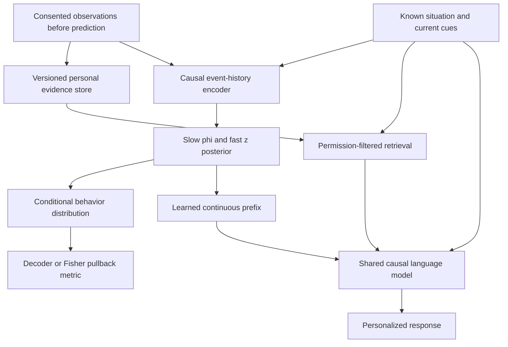

# Modern LLM Approaches to a Personality Manifold

Research design brief for ManifoldLLm. Prepared 2026-10-11.

**Reading guide:** [Recommendation](#recommendation), [five designs](#routes),
[manifold mathematics](#geometry), [experiments](#experiments),
[annotated papers](#references).

This is a curated design investigation, not an exhaustive literature review or
a report of new experiments. Sources support individual components; **no cited
paper proves that the proposed combination captures a complete person or is the
best architecture for this project**. The recommendations below are engineering
judgments with explicit tests that could overturn them.

## 1. Decision and Scope

The research goal should be an **updateable, uncertainty-aware model of a
consenting person's behavior across situations**, not a claim to contain that
person's entire personality. Language, traits, temporary affect, memories,
values, and preferences are related but are not interchangeable.

The central hypothesis is that a causal Transformer, conditioned on a persistent
slow person state and a faster situation-dependent state, can generalize a
person's behavior better than text conditioning alone. A second, independent
hypothesis is that a learned manifold metric improves this generalization over
the same model with Euclidean geometry. Neither hypothesis follows simply from
using a newer architecture.

**Recommended immediate study:** Route A, a small causal Transformer trained
from scratch, preserving the existing manifold heads and losses for the first
comparison. This respects the currently documented project constraint and
isolates the backbone question. It is a small language-model experiment, not
equivalent to training a capable general-purpose LLM.

**Recommended eventual system, if pretrained weights are permitted:** combine
Route B's shared, pretrained decoder-only LLM and learned person-state prefix
with Route C's explicit episodic memory. Start with a frozen backbone, a small
history encoder, a probabilistic slow/fast state, and a behavior decoder. Add a
shared LoRA adapter only if prefix conditioning proves insufficient. Investigate
the manifold on the behavior decoder, not on arbitrary LLM weight distances.

**Why prioritize this combination?** It separates language competence, personal
evidence, behavioral generalization, and geometry into components that can be
tested independently. It also permits new observations to update a person's
state without retraining a separate LLM for every person. These are practical
advantages, not an established performance ranking.

The strongest proposed research contribution is therefore:

> Can an uncertainty-aware, longitudinal person representation improve
> context-dependent behavioral prediction and language personalization, and
> does a behavior-grounded manifold add value beyond an equally capable
> Euclidean representation?

## 2. What the Repository Actually Contains

| Existing component | What it supports | What it does not establish |
| --- | --- | --- |
| [small_language_model/core.py](small_language_model/core.py) | Scratch-trained token embeddings, a causal GRU, and next-token prediction | A pretrained semantic model, persistent memory between calls, or person-level state |
| [Alexander/model.py](Alexander/model.py) | Sentence-level affect/private posteriors, feature reconstruction, and affect-conditioned token prediction | That the private code is identity or personality; that VAD describes a whole person |
| [Alexander/GRU_AND_METHODS.md](Alexander/GRU_AND_METHODS.md) | Separates the encoder, objectives, and decoder geometry | Evidence that one architecture or geometry is already superior |
| [README.md](README.md) | Describes a longitudinal slow coordinate `phi`, fast coordinate `z`, and decoder-derived geometry | A validated digital personality or a demonstrated advantage over Euclidean geometry |
| [Ethan/PSYCHARCHIVES_MANIFOLD_IMPLEMENTATION.md](Ethan/PSYCHARCHIVES_MANIFOLD_IMPLEMENTATION.md) | Person-history estimation, including an ordered, missingness-aware GRU and a slow/fast transition model | A completed integration with Alexander's language model |

The GRU returns one hidden vector per token through `encode_tokens`. Replacing
that computation with causally masked attention is a plausible local backbone
experiment; it does not by itself add person-level learning. Alexander's
whole-sentence pooling must remain outside the causal next-token prediction
path, or a replacement could accidentally leak future tokens.

There are **two different sequence problems**: tokens within an utterance and
observations across a person's history. Replacing the shared token GRU does not
replace Ethan's event-history GRU. Change and evaluate them separately.

The existing notes describe a no-pretrained-LLM constraint. This document treats
scratch training as the currently compatible route and pretrained models as
conditional proposals requiring approval. It does not change that constraint.
Existing licensed-data restrictions also continue to apply.

### Existing Results Must Shape the Next Experiment

- [Ethan/PSYCHARCHIVES_GEOMETRY_TRAINING_RESULTS.md](Ethan/PSYCHARCHIVES_GEOMETRY_TRAINING_RESULTS.md)
	reports development trait-probe macro $R^2$ of 0.135 for Euclidean identity
	training and 0.138 for decoder-path identity training. Other readouts disagree
	about the winner. The supported finding is a benefit from same-person
	contrastive learning, not a distinct manifold advantage.
- [Ethan/PSYCHARCHIVES_FEATURE_GROUP_RESULTS.md](Ethan/PSYCHARCHIVES_FEATURE_GROUP_RESULTS.md)
	reports that a post-hoc mean-plus-standard-deviation valence baseline reaches
	trait macro $R^2=0.159$, exceeding every learned feature-group model in that
	comparison. This is development-only, repeatedly inspected evidence, not a
	final test result. Do not combine the two reports into a single matched table.
- The selected PsychArchives data have repeated person-linked cues and traits,
	**but no participant-linked language**. EmoBank sentence labels do not fill
	that gap. Joining these unrelated datasets does not create a text-to-person
	training signal. A real integration needs consented, linked observations or
	must be labeled an interface-only demonstration.

Replacing a GRU may improve representation capacity, but it cannot repair an
unmeasured target or missing supervision. Model age alone is also a weak
argument: the Transformer dates to 2017 [R02](#r02), and modern Mamba systems
still use recurrence [R10](#r10). The case for modernization is better language
transfer, more suitable history processing, and testable conditioning.

## 3. What Should Represent a Person?

### Personality Is a Conditional Distribution, Not One Adjective Vector

Fleeson's experience-sampling work [R01](#r01) motivates distinguishing stable
patterns from variable momentary behavior. An often-quiet person can speak
confidently in a familiar setting. A model that always generates the same
"introverted" style could be less faithful than one that changes appropriately.

| Component | Proposed representation | Evidence needed |
| --- | --- | --- |
| Relatively stable dispositions | Slow latent state with uncertainty; measured traits as partial anchors | Repeated observations across contexts, independent trait measures |
| Temporary affect and goals | Fast latent state and explicit current context | Current cues and subsequent behavior, not just historical averages |
| Values and preferences | Context-dependent choice probabilities | Choices, trade-offs, and participant feedback |
| Autobiographical facts | External, provenance-linked memory | Consented source records, timestamps or ordering, corrections |
| Communication style and social role | Conditional language behavior | Real responses across audiences and situations |
| Unknown or changing aspects | Posterior uncertainty and versioned updates | Calibration and prospective observations |

Big Five measures can anchor a limited measurement model; they are not a complete
definition of a person. VAD measures affect, not identity. A vector learned only
to distinguish participants might encode their device, vocabulary, or schedule
instead of psychologically meaningful dispositions.

### A Concrete Representation

For person $i$ at observation step $t$, define:

- $H_{i,<t}$: observations available before the response being predicted.
- $c_{i,t}$: known situation, prompt, and allowed current cues.
- $\phi_{i,t}$: slowly evolving person coordinates.
- $z_{i,t}$: faster affective or situational coordinates.
- $M_{i,<t}$: versioned personal evidence store, separate from model weights.

Infer an approximate posterior rather than declaring one coordinate certain:

$$
q_\psi(\phi_{i,t},z_{i,t}\mid H_{i,<t},c_{i,t}).
$$

Use it in two observable prediction paths:

$$
p_\eta(b_{i,t}\mid\phi_{i,t},z_{i,t},c_{i,t}),
\qquad
p_\theta(y_{i,t}\mid c_{i,t},M^{\mathrm{ret}}_{i,<t},
U_\omega(\phi_{i,t},z_{i,t})).
$$

Here $b$ is a measured behavior or choice, $y$ is a response generated
autoregressively, $M^{\mathrm{ret}}$ contains retrieved evidence, and $U_\omega$
maps the state to continuous LLM conditioning. Predictive distributions should
average over posterior samples when assessing uncertainty. A Gaussian posterior
is a starting approximation, not a guarantee of calibration or multimodality.

**The shared manifold describes a family of behavioral patterns learned across
people. An individual occupies an uncertain region and follows a trajectory
through it.** That is more defensible than saying that each person is one fixed
point, or that fitting one person's diary recovers the universal human manifold.
The latent dimension is a model-selection choice, not necessarily three or five.

This is a proposed architecture. Persisting memory and posterior versions must
be implemented explicitly; a context window or a recurrent hidden state is not
a durable, auditable personal record. Generated responses must not silently
become new observations about the real person.

## 4. Five Candidate Designs

These are proposals, not implemented repository features. Several can be combined
after their individual contributions have been tested.

| Route | Language approach | Manifold connection | Best reason to investigate |
| --- | --- | --- | --- |
| [A](#route-a) | Small scratch-trained causal Transformer | Existing latent decoder first; person-level decoder next | Controlled modernization under current constraints |
| [B](#route-b) | Pretrained decoder-only LLM with a state-conditioned prefix | Differentiable state-to-prefix map and behavior decoder | Strong language interface with a compact, updateable person model |
| [C](#route-c) | Retrieval-augmented LLM with structured memory | Evidence estimates the state; geometry is an additional component | Auditable memory and a strong non-manifold personalization baseline |
| [D](#route-d) | Mamba-2 or attention/state-space hybrid | History state estimates the same slow/fast posterior | Longitudinal scaling when history length is a measured bottleneck |
| [E](#route-e) | LLM plus a probabilistic, person-conditioned preference model | Fisher geometry of conditional choice distributions | Model what a person chooses, not only how they sound |

### A. Small Causal Transformer Trained From Scratch

**Architecture.** Replace the token-level GRU with masked self-attention,
positional information, feed-forward layers, and normalization. Preserve the
`encode_tokens` output contract, padding behavior, and existing downstream heads
in the first experiment. A starting pilot might use 2-4 layers, width 128 or
256, and a short context window; these are proposed search settings, not
paper-derived optimal hyperparameters. Report actual parameter counts.

**Manifold integration.** Initially keep Alexander's affect/private decoder
unchanged to test the encoder alone. In a separate person-level experiment,
replace the event-history GRU with a causal event Transformer while retaining
the slow/fast posteriors, decoder, and targets. The eventual language model
receives person-state prefixes, but that is an additional experiment requiring
linked data, not part of the first backbone comparison.

**Evidence.** [R02](#r02) establishes the attention architecture and reports
translation results; [R13](#r13) establishes why a nonlinear generative decoder
can induce useful latent geometry. Combining them here is our proposal.

**Why it could be best now.** It fits the existing scratch-training rule, uses
standard tooling, and allows attribution of changes to the encoder. Attention
can directly relate distant positions inside the permitted context instead of
requiring all information to pass through successive GRU states.

**Limits.** A small model trained on affect-labeled sentences does not acquire
the broad semantic competence of a pretrained LLM. Full attention has quadratic
sequence-length interactions; greater parallelism does not guarantee faster
execution on the available device. Attention also supplies no permanent memory.

**Decisive test.** Compare GRU and Transformer with the same corpus, tokenizer,
heads, objectives, splits, and tuning budget. Report capacity-matched and
compute-matched comparisons separately where both cannot be matched at once.
If the Transformer does not help, retain that negative result. A vocabulary or
pretraining change must not be attributed to attention.

### B. Pretrained LLM With a Hierarchical Person-State Prefix

**Architecture.** Use one open-weight decoder-only Transformer for everyone.
A small causal history encoder estimates $q_\psi(\phi,z)$; a shared network
$U_\omega$ converts its samples into layerwise prefix key/value states. The LLM
attends to those prefixes while answering. Begin by freezing its base weights.

As a concrete, reproducible candidate, investigate **Qwen3-1.7B**, with
**Qwen3-4B** as a larger comparison only after profiling resources. The technical
report [R19](#r19) describes these dense models. This is a candidate selection,
not a claim that Qwen3 is the latest or best personality model. Pin the exact
checkpoint, tokenizer, chat template, and inference mode; use the same
non-thinking configuration across the first comparisons.

**Manifold integration.** $U_\omega(\phi,z)$ provides a differentiable bridge
from continuous person coordinates to token probabilities. The primary metric
should come from a compact behavior decoder using those same coordinates.
Geometry of the LLM's conditional output distributions can be a later,
more expensive comparison. A prefix need not consist of human-readable words.

**Evidence.** Prefix-Tuning [R03](#r03) demonstrates continuous conditioning of
frozen language models. LoRA [R04](#r04) and QLoRA [R05](#r05) support economical
adaptation if needed. They do not test this history-conditioned personality
posterior. [R08](#r08) gives more directly relevant evidence that individual
self-report information can improve LLM-based predictions of individuals.

**Why it could be best for the eventual language system.** The personal dataset
can focus on person-specific variation rather than also teaching grammar and
general knowledge. A new person's state can be inferred from history instead
of requiring a new full model. Keeping evidence outside the shared weights
also makes provenance and correction easier to manage.

**Limits.** Requires approval to use pretrained weights and suitable compute.
The LLM may ignore the prefix, follow stereotypes, or let its default assistant
style dominate. Few trainable parameters do not imply low total inference or
activation memory. QLoRA's reported CUDA/GPU results are not a promise that its
training stack works unchanged on this macOS machine.

**Decisive test.** With one frozen backbone and identical history access, compare
a plain-language profile, a learned prefix, and no person state. Shuffle the
person state between context-matched participants. Useful conditioning must
improve held-out person-specific outcomes, not just produce fluent differences.

Prefer a shared conditional adapter over an independent LoRA for each person
initially. Independent adapters can memorize small histories and do not provide
a common identifiable personality map. Low rank is an adaptation property, not
evidence that personality itself has that rank.

### C. Retrieval-Augmented LLM With Structured Episodic Memory

**Architecture.** Store observations with source, event order or time, situation,
permissions, and observation-versus-inference status. Retrieve relevant records
from the selected person's permitted history; pass them to a shared LLM.
Start with simple lexical retrieval and a recency baseline before introducing
a learned retriever. A relationship or event graph can organize evidence, but
need not replace the initial straightforward store.

**Manifold integration.** Estimate the slow/fast posterior from the history and
provide it alongside retrieved evidence. Retrieval supplies facts; the latent
state is intended to generalize behavior to situations not explicitly recorded.
A retrieval index or knowledge graph is **not itself proof of a smooth manifold**.
Keep retrieval fixed when testing the additional effect of geometric training.

**Evidence.** RAG [R06](#r06) supports combining parametric generation with
external evidence. Generative Agents [R07](#r07) tests memory, reflection, and
planning for believable simulated agents. LaMP [R09](#r09) directly evaluates
user-history retrieval for personalized language tasks. [R08](#r08) studies
simulations grounded in actual individuals' interviews and surveys.

**Why it could be best for an early usable prototype.** It can produce traceable
personalization before training a complex latent model. Facts can be corrected
in the evidence store without full LLM fine-tuning. It is also the strongest
baseline against which to ask whether a manifold adds anything useful.

**Limits.** Correct recall is not personality understanding. Retrieval can miss
contradictions, overemphasize salient episodes, or leak another person's data
without strict isolation. Reflections generated by an LLM remain inferred
summaries, not new ground truth. Graph construction introduces additional errors.

**Decisive test.** Separate factual-memory questions from novel-situation
behavioral predictions. Compare retrieval-only, state-only, and both, holding
the prompt-token budget and available history fixed. If retrieval explains the
whole gain, report that result instead of claiming manifold-based personalization.

**Important source correction.** The 2024 version of [R08](#r08), titled
*Generative Agent Simulations of 1,000 People*, reported the widely repeated
85% figure. Its June 2026 revision has a new title and reports 83%, 82%, and 86%
for interview-only, survey-only, and combined agents on held-out General Social
Survey items, relative to participants' own two-week test-retest consistency.
These are **not percentages of personality captured**, and not 83-86% raw
accuracy. The study concerns 1,052 Americans and specified outcomes; it does not
establish indefinite stability, comprehensive identity reconstruction, or a
Riemannian personality geometry.

### D. Mamba-2 or an Attention/State-Space Hybrid

**Architecture.** Use a selective state-space model for ordered event history,
with attention where explicit access to earlier content is useful. The most
conservative experiment replaces only the event-history encoder, leaving the
language decoder and person-state outputs fixed. Replacing the language model
itself with a hybrid is a separate, larger intervention.

**Manifold integration.** The state-space encoder estimates the same $\phi,z$
posterior and uses the same behavior decoder as the Transformer condition.
An internal recurrent state is a computational summary, not automatically a
personality coordinate. The explicit decoder supplies the candidate geometry.

**Evidence.** Mamba [R10](#r10) and Mamba-2 [R11](#r11) support efficient selective
state-space sequence modeling. Jamba [R12](#r12) demonstrates a language model
interleaving attention and Mamba layers. Its mixture-of-experts component is
not necessary for our initial comparison and does not define personality types.

**Why it could be best later.** Long, streaming histories may make full attention
too costly. State-space updates can reduce sequence-length costs while keeping
explicit memory available for exact episodic retrieval.

**Limits.** Compression may lose rare but important episodes. Kernel support,
hardware, and higher-order differentiation must be checked. Published throughput
numbers cannot be transferred to this repository without measurement. Linear
sequence scaling does not mean perfect lifelong memory or automatic handling of
irregular elapsed time.

**Decisive test.** Plot predictive quality, update latency, and peak memory
against history length. Compare to a hierarchical or windowed event Transformer
and simple history summaries, not only an unnecessarily expensive full-history
baseline. Adopt the hybrid only if it improves a relevant resource-quality trade-off.

### E. Probabilistic Preference Functions With an LLM Interface

**Architecture.** Learn how a person chooses between alternatives in context.
Use a history-conditioned latent model, inspired by Neural Processes
[R17](#r17), to represent uncertainty over possible preference functions.
An LLM supplies a language interface and candidate responses; a compact
person-conditioned model predicts choices or ranks candidates.

For alternatives $u$ and $v$, an illustrative choice model is:

$$
P(u\succ v\mid\phi,z,c)
=\sigma\!\left(r_\eta(u,c,\phi,z)-r_\eta(v,c,\phi,z)\right).
$$

Here $r_\eta$ is learned utility and $\sigma$ is the logistic function. This is
a modeling assumption, not a universal law of human decisions. Integrating over
$q_\psi(\phi,z)$ represents uncertainty about the person's preferences.

**Manifold integration.** Define local distance through changes in these choice
probabilities using the Fisher metric in Section 5. Two coordinates are close
when they predict similar behavior over a specified set of situations, even
if their raw latent vectors or surface writing styles differ.

**Evidence.** Neural Processes support learning distributions over functions
from context observations, not personality specifically. DPO [R16](#r16)
supports preference-based language-model adaptation. A person-conditioned DPO
extension would require participant-linked preference pairs; ordinary pooled
DPO does not automatically preserve individual disagreements. [R14](#r14)
provides the information-geometric foundation and a limited movie-preference
example, not validation of the proposed combined architecture.

**Why it could be best for the scientific target.** It asks directly whether
the system predicts what a person would choose in a new situation, rather than
whether it repeats trait words. It naturally distinguishes population defaults,
individual variation, and uncertainty from sparse evidence.

**Limits.** Requires real, sufficiently diverse preference observations.
Preferences vary with stakes, context, and time; hypothetical choices need not
equal actual behavior. Neural-process uncertainty also needs calibration, and
a static set encoder alone does not model temporal change. Keep event order in
the history representation when change is a target.

**Decisive test.** Hold out both future choices and situation categories. Compare
population-only preferences, a simple hierarchical logistic or factor model,
a deterministic person embedding, and the probabilistic version. DPO should be
an optional downstream experiment after predictive validity is established.

## 5. How the Manifold Should Enter the Model

### 5.1 Geometry of Observable Behavior

For a smooth decoder $F_\eta(\phi,z,c)$ of continuous, standardized behavioral
features, hold $z,c$ fixed and define:

$$
J_\phi=\frac{\partial F_\eta(\phi,z,c)}{\partial\phi},
\qquad
G_{\mathrm{dec}}(\phi;z,c)=J_\phi^\top W J_\phi.
$$

$W$ specifies feature scales or weights; estimate scaling on training data and
fix the weighting policy before evaluation. With $W=I$, this is the familiar
decoder pullback used in this project's geometry. This deterministic form is a
special case of the broader generative-geometry motivation in [R13](#r13);
it does not include all stochastic-decoder uncertainty terms studied there.

**Interpretation:** a small coordinate movement is large if it makes a large
change to predicted behavior. Reconstructing arbitrary hidden features instead
would define geometry of those features, which may emphasize vocabulary or
device usage rather than personality. This is why the measurement target
matters as much as the backbone.

For a categorical choice distribution or other probabilistic outcome decoder,
use the Fisher pullback [R14](#r14):

$$
G_{\mathrm{F}}(\phi;z,c)
=\mathbb E_{b\sim p_\eta(\cdot\mid\phi,z,c)}
\left[
\nabla_\phi\log p_\eta(b\mid\phi,z,c)
\nabla_\phi\log p_\eta(b\mid\phi,z,c)^\top
\right].
$$

Under the usual smoothness and regularity assumptions, with $z,c$ fixed:

$$
D_{\mathrm{KL}}\!\left(p_\phi\,\|\,p_{\phi+\delta}\right)
=\frac12\delta^\top G_{\mathrm{F}}(\phi)\delta
+o(\|\delta\|^2).
$$

This gives a precise, local meaning to similarity: nearby states induce small
changes in predicted outcome distributions. It remains **model- and
task-dependent**, not a discovered universal psychological distance.

Use a compact choice or behavior head first; a full autoregressive LLM Fisher
calculation is much more expensive. Differentiating probabilities or continuous
prefix states is appropriate; differentiating sampled discrete words as though
they were a smooth decoder is not.

For comparisons across people, use identical reference situations and fast
states, or average metrics under one prespecified reference distribution. Using
each person's different context mixture would confound personality distance
with exposure to different situations. Fixing $z=0$ is a reference convention,
not proof that zero is a psychologically neutral state.

### 5.2 What Paths Mean

For a fixed reference metric, the length of a connecting curve is:

$$
L_G(\gamma)=\int_0^1
\sqrt{\dot\gamma(s)^\top G(\gamma(s))\dot\gamma(s)}\,ds,
\qquad
d_G(\phi_0,\phi_1)=\inf_{\gamma(0)=\phi_0,\,\gamma(1)=\phi_1}L_G(\gamma).
$$

A numerically integrated straight coordinate path is a **path-length
approximation**, not automatically a shortest geodesic. Geodesic computation
requires optimizing the path or solving the appropriate equations. Neither a
shortest path nor interpolation between participants establishes a realistic
human developmental trajectory or a causal personality intervention.

### 5.3 Make Geometry Affect Something Testable

Choose one mechanism at a time:

1. **Training:** compare otherwise identical same-person contrastive losses
	 using Euclidean distance versus normalized decoder-path distance. Include
	 the existing scale-invariance safeguard and nuisance controls. Identity
	 matching is a diagnostic, not the primary personality claim.
2. **Updating:** compare an ordinary slow-state regularizer with a local
	 behavior-change penalty based on $\delta^\top G\delta$. Test whether it
	 reduces unjustified drift without suppressing genuine change. This is a
	 proposed extension, not a result of the cited papers.
3. **Analysis:** display response sensitivity and uncertainty along supported
	 paths. If geometry is used only for visualization, describe it as analysis,
	 not as a reason language generation improved.

### 5.4 Conditions That Could Invalidate the Interpretation

- $J_\phi$ must have adequate rank for a nondegenerate pullback on all claimed
	dimensions. A single scalar output cannot provide a full-rank deterministic
	metric for a multidimensional person state at one fixed context.
- Adding $\epsilon I$ helps numerical stability but does not recover missing
	behavioral information or prove intrinsic curvature. A location-varying metric
	can still describe intrinsically flat geometry in nonlinear coordinates.
- Check posterior collapse, sensitivity to output units, metric inflation, and
	whether predictions actually change with the person state.
- Test uncertain regions and data support along paths. [R14](#r14) explicitly
	notes that meaningful paths depend on well-calibrated decoder uncertainty;
	the Fisher construction alone does not guarantee plausible interpolation.
- Latent axes are not automatically identifiable psychological traits. Separate
	heads, low covariance, and KL regularization do not prove semantic separation
	[R15](#r15). Anchors and repeated, independently evaluated outcomes are needed.
- Do not define personality distance by raw LoRA factors. The transformations
	$A\mapsto aA$ and $B\mapsto B/a$, for nonzero scalar $a$, leave $BA$ unchanged
	while changing factor-space distances. Compare behavior or distributions.

**Why not force a sphere or hyperbolic space immediately?** Poincare embeddings
[R20](#r20) are motivated by hierarchical data. Personality is not known here to
be a tree. Test Euclidean geometry and a learned pullback first; introduce fixed
curvature or product manifolds only for an explicit structural hypothesis.
A two-dimensional UMAP/Isomap picture alone is not that evidence.

## 6. Recommended Build Sequence and Costs

| Stage | Deliverable | What it can establish | Gate before continuing |
| --- | --- | --- | --- |
| 1 | Matched scratch GRU/Transformer token experiment | Whether the encoder matters for current language/affect tasks | Causality and padding tests; fair capacity/resource accounting |
| 2 | Separate event-history Transformer experiment | Whether modern history encoding improves the existing person task | Beat history-summary baselines; no claim of linked-language learning |
| 3 | Consented text-linked pilot plus retrieval baseline | Whether the collected evidence supports useful personalization | Confirm data rights and prospective evaluation protocol |
| 4 | Shared LLM with inferred person prefix, if permitted | Whether a compact person state adds to available memories | Beat plain-profile and retrieval-only controls |
| 5 | Euclidean versus behavior-grounded metric | Whether geometry has incremental value | Prespecified effect and uncertainty on untouched outcomes |
| 6 | Preference-function or long-history extension | Whether an identified remaining limitation is addressed | Evidence of missing behavioral generalization or a history-cost bottleneck |

If pretrained weights remain prohibited, retain the scratch model in stages
3-5 and narrow the language task accordingly. Do not silently use a pretrained
embedding model, synthetic LLM labels, or an external LLM judge to bypass that
constraint. A learned retriever is optional; lexical retrieval remains possible.

**Relative cost, not a benchmark:** small scratch models are inexpensive to run
but expensive to turn into broadly capable language models through data alone.
Retrieval minimizes adaptation work but adds prompt and indexing costs. Prefix
or LoRA adaptation reduces trainable parameters while retaining backbone memory
costs. Mamba introduces more implementation/hardware risk. Preference modeling
may make data collection, rather than computation, the limiting resource.

Profile one forward/backward pass on available hardware before committing to
model size or quantization. Record total and trainable parameters, token/event
budgets, context length, precision, peak memory, training time, and update latency.
Do not promise laptop training of a particular model without this check.

### Training and Updating the Recommended Model

Train across participants so that the encoder learns to infer a new person's
state from a limited history, rather than learning a lookup table of person IDs.
Start with a population prior and let limited evidence retain substantial
uncertainty. Preserve missingness indicators and modality-specific masks.

A possible objective, with each optional term introduced by ablation, is:

$$
\mathcal L=\mathcal L_{\mathrm{text}}
+\lambda_b\mathcal L_{\mathrm{behavior}}
+\beta\mathcal L_{\mathrm{KL}}
+\lambda_a\mathcal L_{\mathrm{anchor}}
+\lambda_s\mathcal L_{\mathrm{slow}}
+\lambda_g\mathcal L_{\mathrm{geometry}}.
$$

Text and behavior terms are prediction losses on observed targets; KL regularizes
the approximate posterior; anchors use permitted measured constructs; the slow
term expresses a change-rate prior. A reconstruction term can be retained in
the existing decoder experiment. This composite is a proposed regularized
objective, not automatically one exact probabilistic-model ELBO.

First learn a useful Euclidean state with prediction and calibrated uncertainty.
Then test slow/fast separation and anchors. Only then add a geometric objective.
For a frozen LLM, gradients still need to flow through its conditioning path to
the prefix generator; freezing weights must not detach that path.

At inference, retrieve allowed past evidence, infer the state, and predict before
revealing the target outcome. Once a new real observation arrives, append it and
re-estimate the posterior; retraining the shared LLM at every event is unnecessary.
Store state version, evidence references, model version, and uncertainty.
Updating one's estimate of a stable trait is not the same as the trait changing.
Distinguish uncertainty from limited evidence from genuine behavioral variability.

The current PsychArchives selection has questionnaire ordering, not per-prompt
timestamps. Use event-step dynamics there. Clock-time decay or a continuous-time
model would require actual elapsed-time information and a separate protocol.

## 7. Experiments That Could Support or Reject the Approach

### 7.1 Data and Splits

Collect consented interviews or diaries, repeated situation descriptions,
participant responses, selected choices, and optional validated inventories
from the **same participants**. A feasibility pilot tests burden and pipeline
operation; set a confirmatory cohort size using pilot variance and a power or
precision analysis rather than assuming a few participants validate the method.

Keep these evaluations distinct, following the useful separation in LaMP
[R09](#r09):

1. **Known-person future:** infer from an early history and predict later
	 observations. Retrieval and summaries must exclude those future records.
2. **New-person adaptation:** hold out participants from global training. Give
	 each a fixed, limited adaptation history and score disjoint future outcomes.
	 Fit normalizers and population-level priors on training people only.
3. **New-situation transfer:** hold out situation categories to test whether the
	 representation generalizes beyond memorized response templates.

LaMP is a useful personalization benchmark, not a complete longitudinal
personality dataset. Its tasks have different source licenses; public examples
may overlap LLM pretraining data. Respect those limits, and do not assume the
1,052-person interview data can be downloaded or reused without permission.
Keep the existing 69-person PsychArchives test cohort sealed until its own
protocol is fixed. A new language target may require an independent cohort.

### 7.2 Minimum Controlled Comparisons

| Condition | Purpose |
| --- | --- |
| Population-only prediction | Establish whether personal information is needed |
| Simple history summaries and hierarchical regression | Test whether means, variability, and stable offsets explain the result |
| Same LLM with a plain-language profile | Test whether a learned representation beats a straightforward description |
| Same LLM with retrieval only | Test whether episodic recall explains personalization |
| Same LLM with Euclidean slow/fast state only | Establish the contribution of the latent state without memory retrieval |
| Same LLM with Euclidean state plus fixed retrieval | Establish the combined non-manifold reference |
| Same state/LLM/retrieval with learned-metric training | Isolate the incremental geometry contribution |
| State or history shuffled between matched participants | Test whether useful person-specific information is actually used |
| Trait-only and fast-state-only variants | Test whether the two-timescale design adds value |

Do not change the backbone, information access, latent dimension, and loss all
at once. For the geometry comparison, keep the decoder and prediction heads in
both arms; changing only a distance does not justify removing the decoder from
the Euclidean control. Include a learned constant metric when testing whether
location-dependent geometry helps beyond ordinary rescaling.

### 7.3 Measure Fidelity, Not Just Fluency

| Claim | Suitable measurement | Insufficient evidence |
| --- | --- | --- |
| Predicts this person's behavior | Held-out choice log loss/Brier score, task accuracy, participant-clustered uncertainty | Fluent dialogue or correctly naming a trait |
| Represents measured dispositions | Held-out trait $R^2$/RMSE against simple baselines, independent-window reliability | Repeating inventory answers supplied in the prompt |
| Adapts across situations | Held-out-context prediction and appropriate fast-state changes | Unchanging style in every setting |
| Remembers accurately | Verified factual accuracy, source attribution, contradiction and deletion checks | A confident autobiographical story |
| Expresses the person's style | Blinded participant judgments alongside factual and behavioral measures | ROUGE, perplexity, or an LLM judge alone |
| Quantifies uncertainty | Predictive calibration, interval coverage, and error-versus-confidence analysis | Nonzero VAE variance or verbal confidence |
| Benefits from a manifold | Matched predictive improvement plus numerical rank, scaling, and path checks | A curved plot, positive ridged eigenvalues, or participant identification alone |

Average results per participant as well as over all events. Use multiple training
seeds and confidence intervals clustered or bootstrapped by participant; repeated
rows from one individual are not independent subjects. Prespecify a primary
behavioral endpoint and a practically meaningful effect size before the final
test. A nonsignificant result is not proof of equivalence, but it is not evidence
of superiority either.

Include nuisance checks for device/missingness patterns, topic, language style,
and context exposure. Trait tests can be a secondary validity measure, following
the cautions in [R18](#r18), but synthetic trait steerability is different from
faithfully modeling the specific participant.

### 7.4 Stop or Simplify When the Evidence Says To

- If shuffling person state has no measurable adverse effect, useful
	person-specific conditioning has not been demonstrated.
- If summaries or retrieval match the latent model, the more complex state
	has not shown incremental benefit on that target.
- If learned geometry fails to improve the prespecified endpoint over Euclidean
	and constant-metric controls, retain the simpler geometry for deployment and
	report the negative manifold result.
- If a model is overconfident on unseen situations, do not present its output as
	what the person would certainly think or do.

## 8. Responsible Scope and Decisions for the Professor

Use explicit, revocable participant consent with separate permissions for data
collection, model training, simulation, and sharing. Do not ingest third-party
private messages merely because one participant possesses them. Keep licensed
source data and individual-level artifacts out of the repository.

Separate observed facts, inferred attributes, and generated simulations. Permit
correction, export, and deletion of records, embeddings, summaries, and derived
states. Deleting a memory record does not unlearn data already used to train
shared weights; a separate retention/retraining policy is needed. A latent
coordinate is potentially identifying, not an anonymization guarantee.

Authenticate access to each person's store, filter before retrieval, and treat
retrieved text as untrusted data rather than executable instructions. Label the
system as a simulation, never authorize it to impersonate or act for someone
without permission, and keep it out of consequential employment, credit, or
clinical judgments. Behavioral similarity is not consciousness or personhood.

Before implementation, settle four decisions:

1. Are pretrained weights permitted, or is the assessed contribution entirely
	 scratch-trained? This determines whether A or B is the main language route.
2. Is the primary endpoint behavior prediction, dialogue fidelity, or affect
	 estimation? Use one primary claim instead of "full personality captured."
3. Which dataset actually links repeated observations and language to the same
	 consenting people, and which permissions apply?
4. What hardware, participant burden, and evaluation budget are available?

**Bottom line:** modernize the backbone, but make the research about an
observable, updateable person model. Use B+C as the conditional long-term
architecture, A as the immediately compatible study, E as the behavior-focused
research extension, and D only when long-history cost warrants it. The manifold
must earn its place through controlled predictive evidence.

## 9. Annotated Papers and Decision Cross-References

Source check: 2026-10-11. Titles, dates, and stated findings were checked against
primary paper pages or indexed abstracts. Targeted full-text sections were also
checked for R09, R14, and R19. R08's current quantitative summary is from its
version-3 abstract; the full PDF was not extractable in this review. R01's
abstract was available through Europe PMC. Preprints and technical reports are
not represented here as independent peer-reviewed confirmation. Older methods
are included as foundations for modern combinations, not as newly invented LLMs.

**Suggested reading order:** R08 for individual simulation, R09 for evaluation,
R03 for the LLM interface, R14 for geometry, R01 for personality dynamics, and
R15 for limits on latent interpretation.

### R01. Personality as State Distributions

William Fleeson (2001). *Toward a structure- and process-integrated view of
personality: traits as density distribution of states.* Journal of Personality
and Social Psychology, 80(6), 1011-1027.
[DOI](https://doi.org/10.1037/0022-3514.80.6.1011).

**Supports:** experience-sampling evidence for substantial within-person
variation alongside stable distributional summaries. **Does not establish:**
that a neural slow/fast decomposition identifies the true underlying causes.
**Used for:** Section 3, A/B/D/E, and context-sensitive evaluation.

### R02. Transformer Foundation

Ashish Vaswani et al. (2017). *Attention Is All You Need.*
[Paper](https://arxiv.org/abs/1706.03762).

**Supports:** attention-based sequence modeling, parallelizable training, and
reported machine-translation gains. **Does not establish:** superiority over a
GRU on this dataset or a mechanism for persistent personal memory.
**Used for:** A and the architecture underlying B/C.

### R03. Continuous Conditioning

Xiang Lisa Li and Percy Liang (2021). *Prefix-Tuning: Optimizing Continuous
Prompts for Generation.* [Paper](https://arxiv.org/abs/2101.00190).

**Supports:** learned continuous prefixes with frozen GPT-2/BART models for
table-to-text generation and summarization. **Does not establish:** that a prefix
generated from a person's history preserves their personality.
**Used for:** B's differentiable state-to-language interface.

### R04. Parameter-Efficient Adaptation

Edward J. Hu et al. (2021 preprint). *LoRA: Low-Rank Adaptation of Large
Language Models.* [Paper](https://arxiv.org/abs/2106.09685).

**Supports:** adapting frozen pretrained weights through trainable low-rank
updates. **Does not establish:** interpretable person axes, calibrated personal
uncertainty, or a psychological meaning for adapter rank.
**Used for:** B's optional shared adaptation stage.

### R05. Quantized Adaptation

Tim Dettmers et al. (2023). *QLoRA: Efficient Finetuning of Quantized LLMs.*
[Paper](https://arxiv.org/abs/2305.14314).

**Supports:** memory-efficient adaptation through a frozen 4-bit model into
LoRA parameters on the tested hardware. **Does not establish:** support on this
machine, low total memory for every configuration, or personality fidelity.
**Used for:** B's resource options, conditional on profiling.

### R06. Retrieval and Generation

Patrick Lewis et al. (2020, NeurIPS). *Retrieval-Augmented Generation for
Knowledge-Intensive NLP Tasks.* [Paper](https://arxiv.org/abs/2005.11401).

**Supports:** combining a pretrained generator and external retrieval for
knowledge-intensive tasks. **Does not establish:** a personality representation;
the original system uses Wikipedia and a sequence-to-sequence model.
**Used for:** C's separation of external evidence from parametric generation.

### R07. Memory-Based Simulated Agents

Joon Sung Park et al. (2023). *Generative Agents: Interactive Simulacra of
Human Behavior.* [Paper](https://arxiv.org/abs/2304.03442).

**Supports:** memory, retrieval, reflection, and planning; ablations on believable
behavior in a 25-agent simulated environment. **Does not establish:** faithful
reconstruction of 25 real people or a validated personality manifold.
**Used for:** C's memory architecture and the distinction between believability
and person-specific validity.

### R08. Simulating Actual Individuals

Joon Sung Park et al. (2024 preprint; version 3, 2026-06-28).
*LLM Agents Grounded in Self-Reports Enable General-Purpose Simulation of
Individuals.* [Current version](https://arxiv.org/abs/2411.10109v3).
The [2024 version](https://arxiv.org/abs/2411.10109v1) was titled
*Generative Agent Simulations of 1,000 People*.

**Supports:** simulations based on interviews, surveys, or both for 1,052
participants; the current abstract reports held-out GSS accuracy at 83%, 82%,
and 86% of participants' own two-week consistency, versus 74% for demographic-only
agents. **Does not establish:** raw accuracy at those percentages, lifelong
fidelity, full-person capture, or an advantage from manifold learning.
**Used for:** B/C, realistic ambition, and version-specific evidence reporting.

### R09. Personalized Language Evaluation

Alireza Salemi, Sheshera Mysore, Michael Bendersky, and Hamed Zamani
(2023 preprint; 2024 revision). *LaMP: When Large Language Models Meet
Personalization.* [Paper](https://arxiv.org/abs/2304.11406v4).

**Supports:** seven personalized classification/generation tasks, user-based
and time-based splits, and retrieval-based personalization.
**Does not establish:** comprehensive personality validity; results depend on
task/prompt and mostly public data may overlap pretraining. The reported
experiments are single runs. **Used for:** B/C and Section 7. See Sections 2.2,
3, 4, Limitations, and Appendix F for splits, methods, results, and licenses.

### R10. Selective State-Space Modeling

Albert Gu and Tri Dao (2023 preprint; 2024 revision). *Mamba: Linear-Time
Sequence Modeling with Selective State Spaces.*
[Paper](https://arxiv.org/abs/2312.00752).

**Supports:** input-dependent selective state updates and favorable sequence
scaling on the evaluated tasks. **Does not establish:** perfect memory of rare
events or longitudinal personality modeling.
**Used for:** D's history-processing alternative.

### R11. Mamba-2

Tri Dao and Albert Gu (2024, ICML). *Transformers are SSMs: Generalized Models
and Efficient Algorithms Through Structured State Space Duality.*
[Paper](https://arxiv.org/abs/2405.21060).

**Supports:** the state-space duality framework and an efficient Mamba-2 core.
**Does not establish:** that every attention model is interchangeable with an
SSM or that its speedups transfer unchanged to our hardware.
**Used for:** D and the argument that modern recurrence remains worth testing.

### R12. Hybrid Language Architecture

Opher Lieber et al. (2024). *Jamba: A Hybrid Transformer-Mamba Language Model.*
[Paper](https://arxiv.org/abs/2403.19887).

**Supports:** a large-scale language architecture interleaving attention and
Mamba with some mixture-of-experts layers. **Does not establish:** that the
released large model is practical here or that experts correspond to traits.
**Used for:** D's hybrid design precedent, not a required checkpoint.

### R13. Decoder-Induced Geometry

Georgios Arvanitidis, Lars Kai Hansen, and Soren Hauberg (2018, ICLR).
*Latent Space Oddity: on the Curvature of Deep Generative Models.*
[Paper](https://arxiv.org/abs/1710.11379).

**Supports:** a generative-model approach to latent metric distortion and
improved geometric operations in the studied VAE settings.
**Does not establish:** that any learned decoder is full-rank, that a simple
mean-decoder metric captures all uncertainty, or that personality is curved.
**Used for:** A/B and Section 5's decoder-based construction.

### R14. Information Geometry of Outcomes

Georgios Arvanitidis, Miguel Gonzalez-Duque, Alison Pouplin, Dimitris Kalatzis,
and Soren Hauberg (2022, AISTATS). *Pulling back information geometry.*
[Paper](https://arxiv.org/abs/2106.05367v2).

**Supports:** pulling Fisher-Rao geometry from decoder distributions to latent
coordinates, including non-Gaussian outcomes. Section 4.6 explores paths through
MovieLens viewing-pattern representations. **Does not establish:** complete
preferences or personality; viewing a movie is not the same as liking it.
The paper explicitly identifies decoder uncertainty calibration as a limitation.
**Used for:** B/E and Section 5. Read Propositions 3.1-3.3, Section 4.6, and
Section 6; the movie example is methodological precedent, not our validation.

### R15. Limits on Latent Interpretation

Francesco Locatello et al. (2019, ICML). *Challenging Common Assumptions in
the Unsupervised Learning of Disentangled Representations.*
[Paper](https://arxiv.org/abs/1811.12359).

**Supports:** non-identifiability without appropriate assumptions/inductive
biases and extensive empirical cautions about disentanglement.
**Does not establish:** that supervised or temporally structured representation
learning is impossible. **Used for:** interpreting slow/fast/private codes and
requiring independent construct validation.

### R16. Learning From Preferences

Rafael Rafailov et al. (2023). *Direct Preference Optimization: Your Language
Model is Secretly a Reward Model.* [Paper](https://arxiv.org/abs/2305.18290).

**Supports:** a direct preference-training objective without the conventional
separate reward-model/PPO pipeline. **Does not establish:** personalized
alignment from pooled preferences or recovery of a person's values.
**Used for:** E's optional language-adaptation stage, not the core state estimator.

### R17. Distributions Over Functions

Marta Garnelo et al. (2018 preprint). *Neural Processes.*
[Paper](https://arxiv.org/abs/1807.01622).

**Supports:** latent-variable models that condition on observations to represent
distributions over functions and adapt to new evidence. **Does not establish:**
calibrated uncertainty in our task, temporal dynamics, or LLM personalization.
**Used for:** E's probabilistic preference-function design; the combination with
an LLM and manifold metric is an explicit research proposal.

### R18. Measuring Synthetic LLM Traits

Greg Serapio-Garcia et al. (2023 preprint; version 4, 2025).
*Personality Traits in Large Language Models.*
[Paper](https://arxiv.org/abs/2307.00184v4).

**Supports:** measurement and shaping of synthetic trait expression in tested
LLMs under specified prompting conditions. **Does not establish:** that an LLM
possesses human personality or faithfully models a particular real person.
**Used for:** trait-prompt baselines and cautious secondary evaluation.

### R19. Concrete Open-Weight Backbone Candidate

An Yang et al., Qwen Team (2025 technical report). *Qwen3 Technical Report.*
[Paper](https://arxiv.org/abs/2505.09388).

**Supports:** publicly released dense and MoE model families, including the
1.7B and 4B dense candidates, with reported language/reasoning benchmarks.
**Does not establish:** personality accuracy or this machine's runtime capacity.
**Used for:** B's candidate selection. See Section 2 and Table 1 for architecture,
and Section 4.3 for thinking/non-thinking configuration. These are technical-report
results, not an independent comparison on this project's data.

### R20. When Hyperbolic Geometry Is Justified

Maximilian Nickel and Douwe Kiela (2017). *Poincare Embeddings for Learning
Hierarchical Representations.* [Paper](https://arxiv.org/abs/1705.08039).

**Supports:** compact hyperbolic representations for data with latent hierarchy.
**Does not establish:** that human personalities have the required hierarchy.
**Used for:** Section 5's decision not to impose fixed negative curvature
without a specific structural hypothesis and a matched comparison.